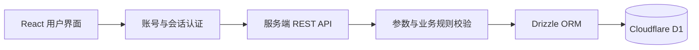
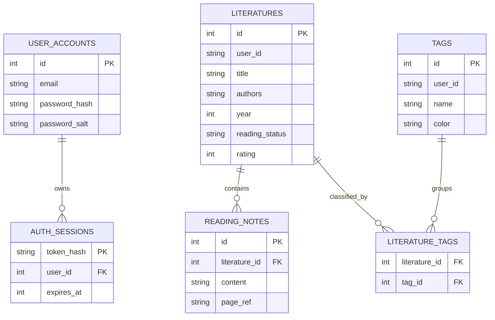

# 文献阅读与笔记管理系统开发设计文档

## 1 项目目标

系统面向需要管理课程论文、科研文献和阅读笔记的学生。它将分散的文献信息、主题标签和个人笔记集中保存，并通过检索、状态管理和统计帮助用户持续跟踪阅读进度。

## 2 功能模块

### 2.1 阅读概览

展示文献总数、阅读中数量、笔记数量、标签数量、阅读状态分布、阅读完成率、年份分布和常用标签。

### 2.2 文献管理

支持文献录入、查看、编辑和删除。核心字段包括标题、作者、发表年份、期刊或来源、DOI、原文链接、摘要、阅读状态和个人评分。

### 2.3 标签管理

支持标签创建、修改、删除和颜色设置。一篇文献可以关联多个标签，一个标签也可以关联多篇文献。

### 2.4 阅读笔记

每篇文献可以关联多条阅读笔记，笔记支持页码或章节定位、修改和删除。

### 2.5 检索与统计

支持标题、作者、期刊和 DOI 关键词搜索，支持阅读状态与标签组合筛选，并提供多种排序方式。统计结果随文献、标签和笔记的增删改实时更新。

### 2.6 账号与数据隔离

首次部署只允许创建一个初始管理员账号，创建成功后公开注册自动关闭。密码使用 PBKDF2-SHA256 加盐哈希保存，登录会话使用随机令牌的 SHA-256 哈希和安全 Cookie。连续五次登录失败后账号锁定十五分钟。所有文献、标签和笔记查询都以当前登录用户为边界。

## 3 系统架构

前端负责表单交互、筛选和数据可视化；后端负责身份隔离、参数校验、重复检查和关联数据维护；D1 负责持久化数据。

## 4 数据模型

## 5 接口设计

| 方法 | 路径 | 作用 |
|---|---|---|
| POST | `/api/auth/register` | 创建唯一的初始管理员账号 |
| POST | `/api/auth/login` | 校验密码并创建登录会话 |
| POST | `/api/auth/logout` | 撤销当前登录会话 |
| GET POST | `/api/literatures` | 查询或新增文献 |
| GET PATCH DELETE | `/api/literatures/{id}` | 查看、修改或删除指定文献 |
| GET POST | `/api/tags` | 查询或新增标签 |
| PATCH DELETE | `/api/tags/{id}` | 修改或删除指定标签 |
| POST | `/api/notes` | 新增阅读笔记 |
| PATCH DELETE | `/api/notes/{id}` | 修改或删除指定笔记 |

## 6 异常与数据一致性设计

- API 对空标题、空作者、空笔记、非法年份、非法评分和非法链接返回明确的 400 错误。
- 未登录的数据请求返回 401，跨来源认证请求返回 403。
- 初始账号创建后再次注册返回 409；连续登录失败触发临时锁定。
- 重复文献和重复标签返回 409 冲突错误。
- 操作不存在或不属于当前用户的数据时返回 404。
- 文献删除通过外键级联清理笔记和标签关联。
- 删除标签只清理关联关系，保留文献核心数据。
- 前端在危险删除操作前弹出二次确认。

## 7 可维护性设计

- 数据结构集中在 `db/schema.ts`，迁移由 Drizzle 自动生成。
- 通用 API 处理集中在 `lib/api.ts`。
- 文献表单校验集中在 `lib/literature-validation.ts`，新增和编辑共用同一规则。
- 阅读状态使用固定枚举值，避免出现无效状态。
- 数据库为用户和常用查询字段建立索引。
